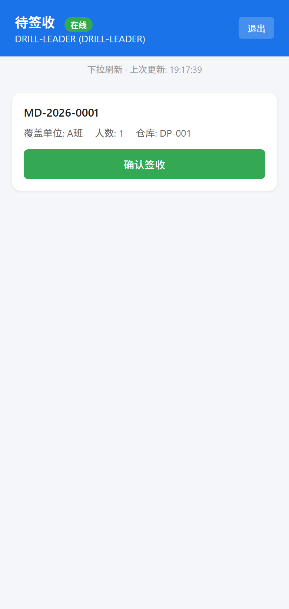
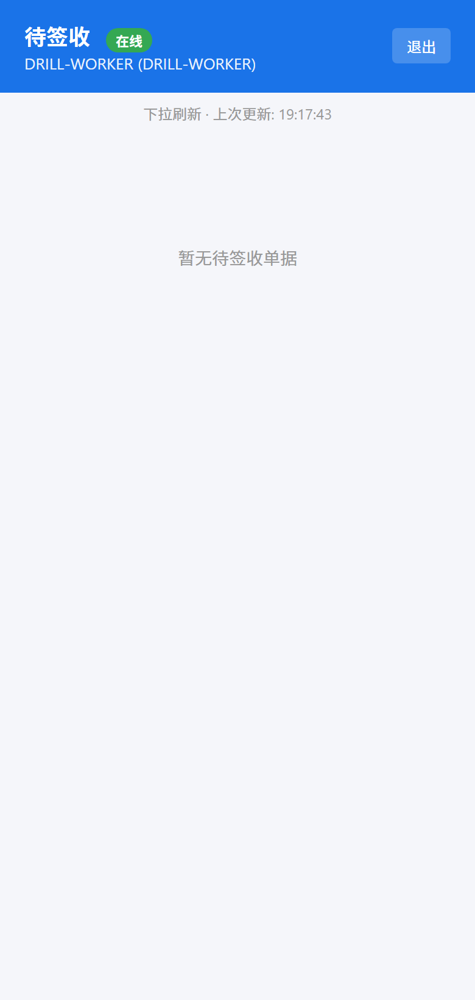
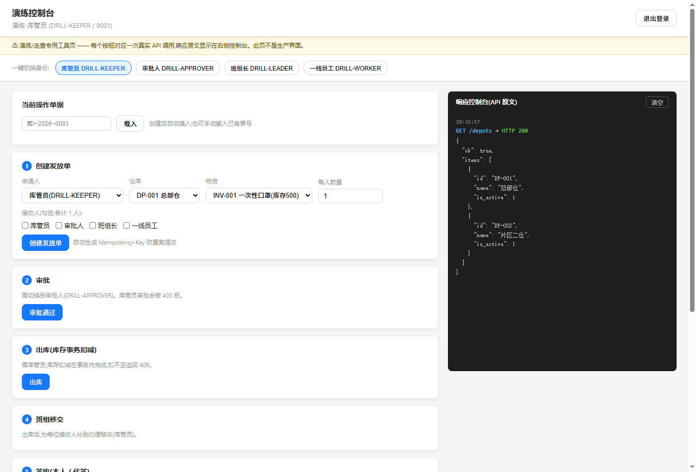
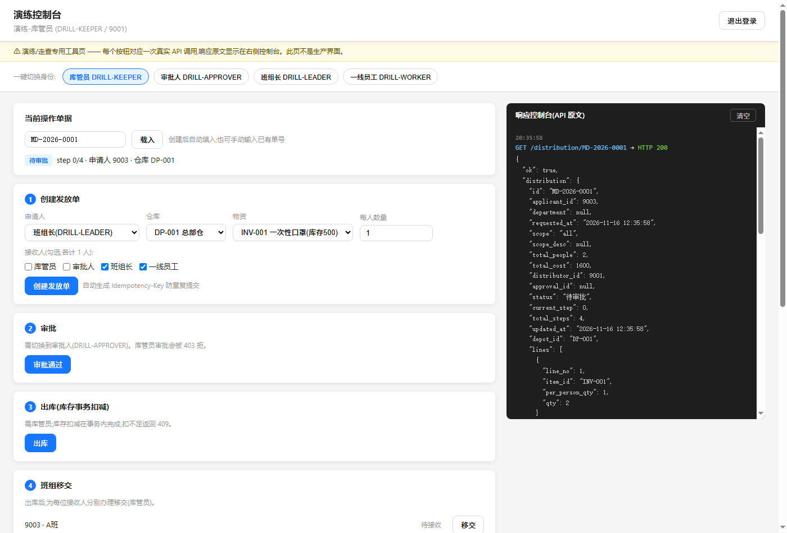
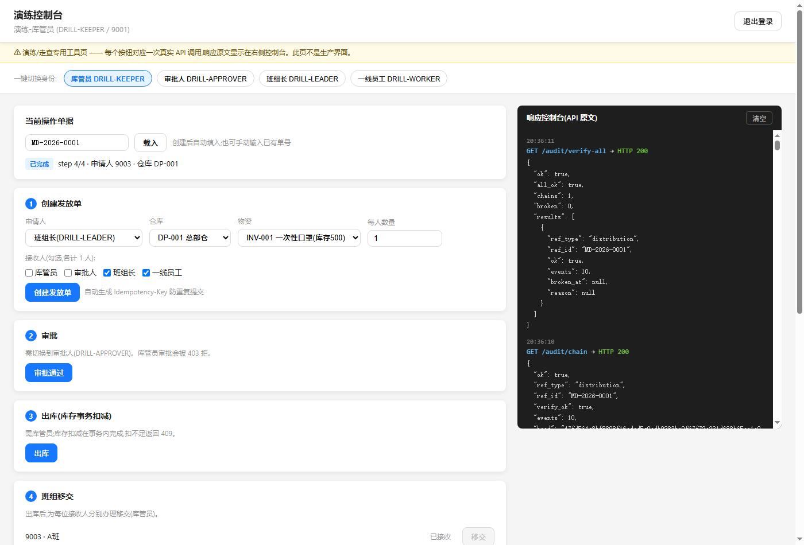

# 系统走查 · 预演集(Walkthrough Dry-Run)

> **2026-11-16 · Qoder 代理预跑** · 目的:在 Daniel 正式坐下来走查之前,先把每个环节跑通,
> 确认"哪些能演示、哪些是缺口、会上需要准备什么"。
> 全程真实服务、真实数据库、真实 UI 点击,**没有一处 mock**。

---

## 0. 环境与复现方式

| 项 | 值 |
|---|---|
| 服务 | Fastify `:8791`(同源,经 `@fastify/static` 托管页面,**无需 Caddy**) |
| 数据 | SQLite WAL(`server/data/warehouse.db`),种子 `node server/seed-drill.js` |
| 驱动 | Edge headless + CDP,脚本 [`shoot.js`](shoot.js) —— 真实点击按钮、真实 fetch 会话 |
| 复跑 | `node docs/walkthrough/shoot.js`(约 20 秒,产出 8 张截图 + [`flow-transcript.json`](flow-transcript.json)) |
| 演练控制台 | [`drill-console.html`](../../drill-console.html) —— 管理端八步(创建/审批/出库/移交/签收/推进/审计/库存)全点击,响应原文右侧可见;驱动脚本 [`shoot-console.js`](shoot-console.js)(产出 6 张截图 + [`console-transcript.json`](console-transcript.json)) |

**怎么起服务(开会当天照做):**

```powershell
cd D:\workspace\sanitation-ai-platform\server
npm install          # 首次
node seed-drill.js   # 灌种子(幂等)
npm start            # → http://localhost:8791
```

手机访问:与服务同一局域网,浏览器打开 `http://<电脑IP>:8791/mobile-sign.html`。

---

## 1. 走查路线(每一步 = Daniel 在会上亲手做的动作)

### ① 登录页 · 移动签收


工号 `DRILL-KEEPER` / 密码 `Aa@123456`。**会上**:Daniel 用自己手机打开,先做这一步。

### ② 库管员登录 → 空待办(健康状态确认)


登录后看到"暂无待签收单据"—— 证明会话(Session)和权限正常。

### ③ 创建发放单 MD-2026-0001(班组长 + 一线,各 1 包口罩)

```
POST /distribution/requests   (带 Idempotency-Key 防重复提交)
→ 201 {"ok":true,"id":"MD-2026-0001","status":"待审批","total_cost":1600}
```

### ④ 审批(审批人 DRILL-APPROVER)

```
→ 200 {"ok":true,"id":"MD-2026-0001","status":"已批准","approval_id":"APR-…"}
```

**会上检查点**:库管员自己审批会被 403 拒 —— 审批与操作必须分人。

### ⑤ 出库 + 双人移交

```
issue   → {"status":"发放中","step":1,"deducted":1}     ← 库存 500→498 事务内扣减
transfer → 班组长(9003) 已移交 / 一线(9004) 已移交
```

### ⑥ 班组长登录 → 看到待签收


**这是会上最关键的一屏**:真实的业务卡片(单号 / 覆盖单位 / 人数 / 仓库)。

### ⑦ 班组长本人签收(真实按钮点击)


点"确认签收" → 通知"签收成功",待办清空。

### ⑧ 越权代签被拒(业务规则验证)
库管员(仓库管理员,**不在**代签白名单)替一线签:

```
→ 403 {"ok":false,"error":"非接收人本人,且岗位不在代签白名单"}
```

### ⑨ 白名单代签(留痕)
班组长(**在**白名单:班组长/车队长/队长)替一线签:

```
→ 200 {"ok":true,"received_by":9004,"signed_by":9003,"mode":"proxy"}
```

**会上检查点**:代签的单子必须能区分"谁收的、谁签的"。

### ⑩ 创建发放单 MD-2026-0002(一线,1 瓶 84 消毒液)→ 全链推进到移交
### ⑪ 一线员工登录 → 待签收


### ⑫ 断网 → 签收入离线队列(P1-T05 新能力)


脚本断网后点"确认签收":**不报错**,单据入离线队列(黄色队列条 + "离线已排队"徽章 + 离线徽标)。

### ⑬ 恢复网络 → 自动重放


联网瞬间队列自动重放,通知"签收成功",队列清空。**幂等键防重复扣减**(P0-T03 服务端 outbox 配合)。

### ⑭ 台账推完 + 审计链验证

```
advance step2→3→4  →  MD-2026-0001 已完成 / MD-2026-0002 已完成
GET /audit/verify-all  →  {"all_ok":true,"chains":2,"broken":0}
    MD-2026-0001: 10 事件 ✓    MD-2026-0002: 8 事件 ✓
GET /audit/chain?ref_id=MD-2026-0001 → {"verify_ok":true,"head":"92fc4af0…"}
```

**会上检查点**:让 Daniel 试着找一条断链 → 找不到,这就是审计链的价值。

### ⑮ 报表(库管员)

```
GET /reports/stock-movements → 3 条 distribution_out 流水, INV-002 qty_after=119
GET /reports/low-stock       → 0 条(无低库存)
```

**库存终值(数据库直查)**:INV-001 口罩 500→**498**,INV-002 消毒液 120→**119**,其余未动。

### ⑯ 策略面板(桌面)


`config.html` —— 代签白名单等策略在线可改、即时生效(P0-T02)。

### ⑰ 演练控制台(管理端八步,全程点击)
  

`drill-console.html` —— ③④⑤ 等管理端环节不再是"只能敲 API":创建(带 Idempotency-Key)→ 审批 → 出库 →
逐人移交 → 本人签/白名单代签 → 推进 step2-4 → 审计链校验 → 库存快照,全部是真实按钮;
顶部一键切换四个演练身份,右侧暗色控制台显示每次 API 的响应原文。

预演实况([`console-transcript.json`](console-transcript.json)):MD-2026-0001 创建→审批→出库→移交→
本人签+代签→已完成 4/4,`/audit/verify-all` `all_ok=true`(1 链 10 事件)。

---

## 2. 结论:演练闭环走得通

| DRILL-SCRIPT 复盘项 | 结果 |
|---|---|
| 库存正确扣减(事务) | ✅ 500→498 / 120→119 |
| 流水写入 stock_movement | ✅ 3 条 distribution_out |
| 本人签收 / 白名单代签 | ✅ 两次都 200 |
| 非白名单代签被拒 | ✅ 403 |
| 离线签收 → 联网重放不重复扣减 | ✅ 入队 + 自动重放 |
| 全流程推到"已完成" | ✅ 2 单 |
| 审计链哈希串联完整 | ✅ verify_all=true,2 链 18 事件 |
| 审计链防篡改(附录) | ✅ 见 VERIFICATION-REPORT §10 |

---

## 3. 预演发现(开会前必须知道)

1. ✅ **P1-T05 已交付**(`72c2174`):离线队列 / 下拉刷新 / 通知 —— 与 P0-T03 服务端 outbox 合起来,弱网签收闭环可用。
   注意口径:用的是 **localStorage**,不是任务定义里写的 IndexedDB —— 功能等价,正式版建议换 IndexedDB。
2. ✅ **管理端后端 UI 已补**([`drill-console.html`](../../drill-console.html),Qoder,CDP 实跑验证):
   管理端八步全部可点击、响应原文可见 —— 走查会上 Daniel 无需敲任何命令。
   (注:`index.html` / `mobile.html` 仍是纯原型,与后端无关;真正连后端的页面 =
   `mobile-sign.html`(签收)、`config.html`(策略)、`depot-console.html`(多仓)、`drill-console.html`(演练工具)。)
3. 🟡 **文档过期数字**(已修正):DRILL-SCRIPT §0.3 写"31 pass"、DEPLOYMENT §6.1 写"54 pass",实际 **137 server + 22 foundation = 159**。
4. 🟡 **演练种子权限缺口**(已修 `seed-drill.js`):库管员原只有 `inventory:edit`,报表接口要 `view` → 全 403;
   现已补 `view`,报表 200。这类"种子与接口对不齐"的坑,只有真跑一遍才暴露。

---

## 4. 会前准备清单(已进入项目计划)

| # | 准备项 | 状态 | 负责 |
|---|---|---|---|
| 1 | 服务能按 DEPLOYMENT 起来(已预演) | ✅ 本次验证 | – |
| 2 | 种子数据 + 权限可走全程(已预演) | ✅ 本次验证 | – |
| 3 | 备份恢复演练(**删库 → 恢复 → 服务正常**) | ✅ **已完成**(2026-11-16 实测 < 2 分钟,DEPLOYMENT §11) | – |
| 4 | 演练控制台单页(管理端点击操作) | ✅ **已完成** | `drill-console.html` 八步全点击;CDP 实跑全链 `verify_all=true` |
| 5 | 真人(非开发)走一遍 DRILL-SCRIPT | 🔴 **未做** | 11-26 冻结前 |
| 6 | 手机同网段访问验证(真人手机) | 🟡 会上第一件事 | Daniel |
| 7 | 演练库重置脚本/流程(`rm warehouse.db*` → 重灌) | ✅ 已有(DEPLOYMENT §8) | – |

---

## 5. 会上需 Daniel 拍板/验收的三件事(简报)

### ① 多仓 UI(P1-T07)验收

| 项 | 内容 |
|---|---|
| 交付 | `depot-console.html`(`c4bc47b`):仓切换卡片 + 汇总卡(项数/总库存/总值/低库存)+ 按仓库存表 + 低库存高亮;后端 `GET /depots` + `GET /inventory?depot_id=` |
| 验收标准 | 任务定义:"各仓库存独立可查" |
| 实测 | 仓切换与按仓表格正常,数据来自真实接口 |
| 待定 | 未登录时跳转 `index.html`(纯原型,不能真实登录)—— 建议把跳转目标改成有真实登录的页面(约 10 行),或纳入后续管理端统一入口 |

### ② 演练控制台验收(已按 Daniel 拍板建好)

| 项 | 内容 |
|---|---|
| 交付 | `drill-console.html`:八步全点击 + 一键切换四个演练身份 + 响应原文控制台;`shoot-console.js` CDP 实跑:MD-2026-0001 全链 + 审计 `all_ok=true` |
| 会上动作 | Daniel 亲手点一遍 创建→审批→出库→签收,确认与业务口径一致 |
| 定位 | 演练/走查专用工具页,**不是**生产界面(页面顶部已标注) |

### ③ 离线队列口径(P0-T03):localStorage vs IndexedDB

| 项 | 内容 |
|---|---|
| 现状 | 服务端 outbox + 幂等重放已交付;前端队列由 P1-T05 用 **localStorage** 实现(任务定义写的是 IndexedDB) |
| 差异 | 功能等价:入队/自动重放/防重复扣减都有;localStorage 容量小(约 5MB)且同步读写,IndexedDB 容量大且异步 |
| 建议 | **演练期接受 localStorage 口径**(不阻塞 Go/No-Go),正式版迁移 IndexedDB —— 进备选池(DEMAND-POOL §D) |
